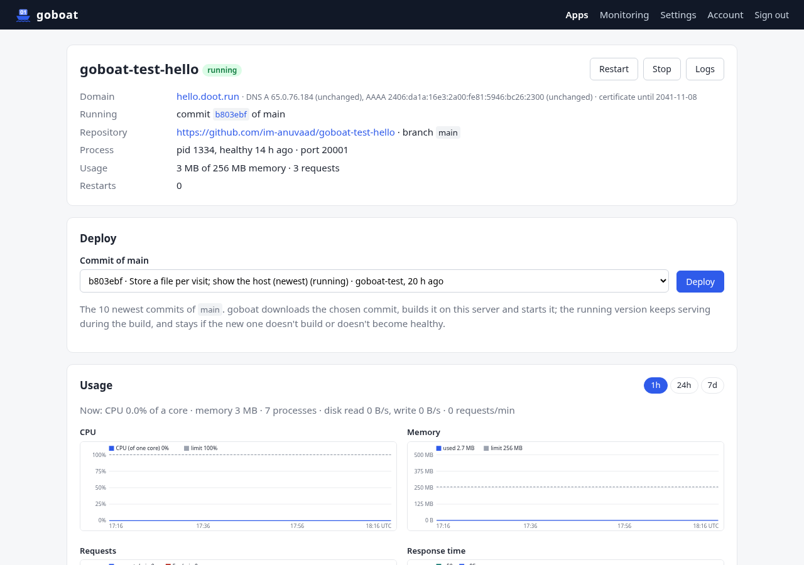

<p align="center">
  
</p>

<p align="center"><b>Push Go + SQLite apps to your own server. goboat builds, runs and backs them up.</b></p>

<p align="center">
  <a href="https://github.com/im-anuvaad/goboat/releases/latest"></a>
  <a href="LICENSE"></a>
  
  <a href="https://x.com/im_anuvaad"></a>
</p>

<p align="center">
  <a href="docs/deployment.md"><b>Deploy goboat</b></a> ·
  <a href="docs/app-contract.md"><b>Write an app</b></a> ·
  <a href="docs/api.md">Status API</a> ·
  <a href="docs/architecture.md">Architecture</a>
</p>

---

## About

goboat is a small, self-hosted platform for **Go web apps that keep their data in SQLite**. It runs on one Ubuntu server behind Cloudflare, as a single binary with a web dashboard.

Connect a GitHub repository, pick a branch and a domain, press **Deploy**. goboat downloads that commit, builds it with Go on the server, runs it as its own Linux user with its own memory and CPU limits, gives it a certificate and DNS record in Cloudflare, and backs its databases up every 10 minutes. No Docker, no release pipelines, no reverse proxy to configure: one SSH command to install, the dashboard for everything else.

```
Cloudflare ──HTTPS (Full strict, origin pulls)──► goboat ──► your Go apps on 127.0.0.1
                                                  builds · deploys · TLS · backups · logs
```



## What you get

| | |
|---|---|
| 🚀 **Deploy a commit with a click** | Builds on the server while the old version keeps serving; the switch takes about 0.2 s. The last 3 builds are kept for one-click rollback. |
| 🔒 **Locked to your Cloudflare** | Origin CA certificates, a Cloudflare-only IP filter and Authenticated Origin Pulls. Every certificate and DNS record goboat stops using is cleaned up. |
| 💾 **SQLite backups** | Every 10 minutes when something changed, and before every deploy, to R2 or any S3-compatible bucket. 48 hours kept, one-click restore. |
| 🧳 **Move servers in two steps** | One command on the new server, **Switch now** on the old one. Measured: under 2 seconds of downtime. |
| 📊 **Logs and monitoring** | Live logs, build logs, CPU, memory, requests and response times per app; a read-only JSON API for scripts and AI agents. |

## Is goboat for you?

**A good fit if** you are one person running a few Go + SQLite apps (side projects, internal tools, small products) and you want them on your own VPS without doing ops.

**Not a fit if** you need any of the [limitations](#known-limitations) below to be otherwise: several servers, high availability, other languages, other databases, or deploys without a human pressing the button.

## Known limitations

- **One server, one account.** No clustering, failover or teams with separate logins.
- **Go only, no cgo.** Apps build with `CGO_ENABLED=0`; use `modernc.org/sqlite`, not `mattn/go-sqlite3`.
- **Only `go build` runs.** No `go generate`, npm, Tailwind or templ CLI on the server: commit generated files. Private Go modules must be vendored; no git submodules.
- **Cloudflare is required.** Every domain must be proxied in your Cloudflare account, in Full (strict) mode. HTTPS only, no port 80, no raw TCP/UDP services.
- **Short downtime per deploy.** The old version stops before the new one starts (safe for SQLite): about 0.2 s plus your app's startup. No blue-green, no deploy on push.
- **Backups cover SQLite only**, at most 10 minutes old, kept 48 hours. Uploaded files in the data folder survive deploys and server moves but aren't backed up.
- **Sized for small servers.** 2 vCPU / 2 GB RAM runs goboat plus 1–2 production apps, or 3–4 small ones. Per app: up to 1 GB of memory, 2 cores, one process; at most 20 apps.
- **Trusted apps.** Apps are separated by Linux users and cgroups, not containers.
- **Ubuntu 24.04+** with systemd and cgroup v2, x86_64 or arm64.

## Quick start

On a fresh Ubuntu 24.04+ server with 2 GB of RAM and ports 22 and 443 open:

```bash
curl -fsSL https://github.com/im-anuvaad/goboat/releases/latest/download/install.sh | sudo bash
```

Open the address it prints, sign in with the one-time password, and follow the dashboard. You'll need a Cloudflare API token, a GitHub token and, for backups, a bucket: **[docs/deployment.md](docs/deployment.md)** has every step, plus updating, moving servers and troubleshooting.

Your app needs a `goboat.toml` and a few conventions (port, data folder, migrations, shutdown): **[docs/app-contract.md](docs/app-contract.md)**. It is written so you can hand it to an AI agent as the brief for a goboat app.

## Documentation

| Document | For |
|---|---|
| [deployment.md](docs/deployment.md) | Installing, using, updating, moving and troubleshooting a goboat server |
| [app-contract.md](docs/app-contract.md) | Writing a Go + SQLite app for goboat (people and agents) |
| [api.md](docs/api.md) | The read-only status API |
| [architecture.md](docs/architecture.md) | How goboat works inside (maintainers) |

## Built with goboat


Hosting your app on goboat? Show it: `docs/assets/goboat-badge-light.svg`.

## Development

Requires Go (version in `go.mod`).

```bash
make build      # dist/goboat for this machine
make build-all  # static linux amd64 + arm64 binaries + checksums.txt
make lint       # gofmt, go vet, staticcheck
make test       # go test -race ./...
```

Releases are built by GitHub Actions from a `vX.Y.Z` tag. How to check a change on a real server first: [architecture.md §13](docs/architecture.md#13-changing-goboat).

## License

[Apache License 2.0](LICENSE) · © 2026 Sumit Yadav · [@im_anuvaad on X](https://x.com/im_anuvaad)
